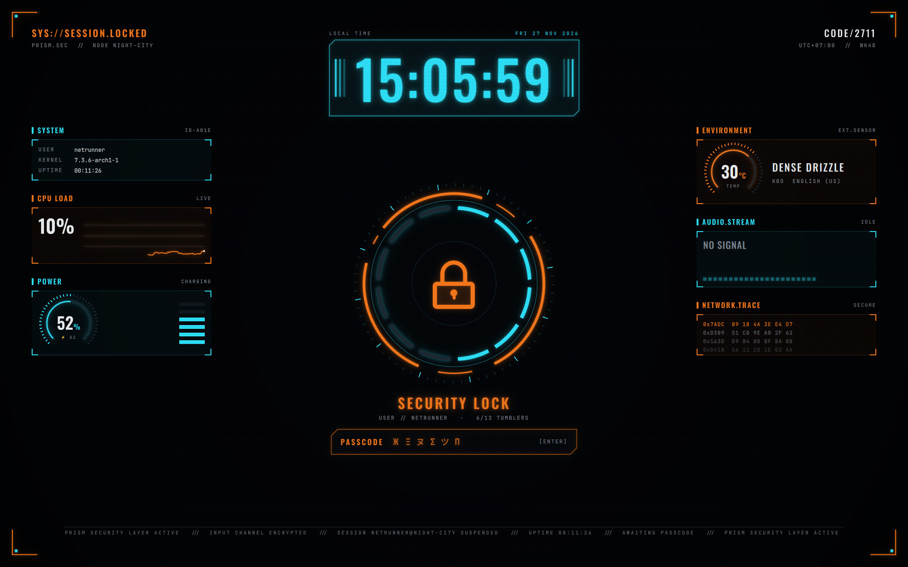
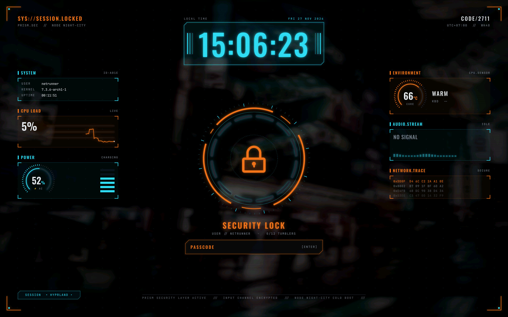
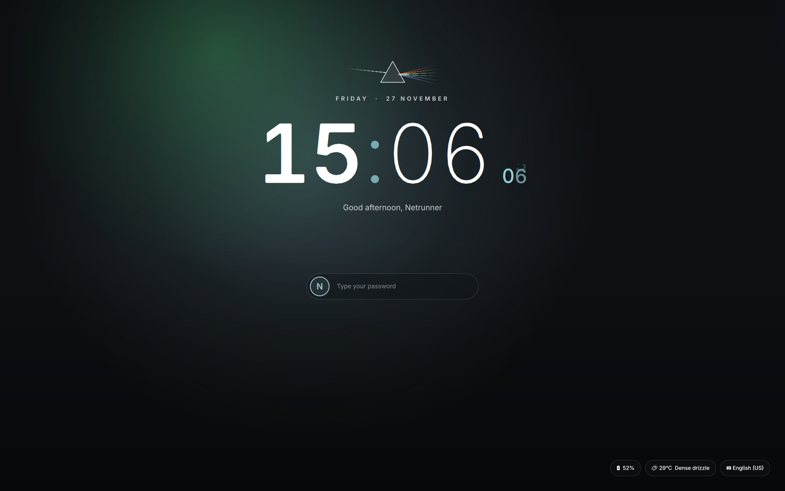
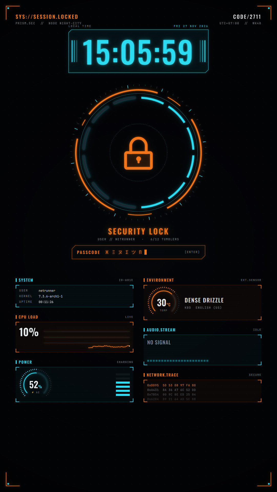

# Prism

A personal Hyprland desktop built with [Quickshell](https://quickshell.org): frosted-glass bar and panels, its own notification center, control center and OSD, daily wallpapers per screen, two animated lock screens and a matching SDDM login, all on a Hyprland 0.57 Lua config.



| Login (SDDM) | Lock, Prism theme | Lock, portrait screen |
|---|---|---|
|  |  |  |

> This is my own setup, shared as is. It works on my machine (Arch, three monitors, one rotated); expect to adapt paths, keybinds and monitor names. Design notes (in Vietnamese) are in [`docs/DESIGN.md`](docs/DESIGN.md).

## Features

- **Bar**: one floating glass bar per screen, adapted to the screen's shape (portrait / 16:10 / wide); workspaces with app glyphs, clock with seconds and now-playing, tray, privacy indicator (mic / camera / screen share), hides over fullscreen windows.
- **Notifications**: Prism is the notification daemon: popups, a panel grouped by app with actions, Do Not Disturb.
- **Control center**: Wi-Fi, Bluetooth and sound pages, quick toggles (night light, dark mode, airplane, game mode, blur, layout), volume / mic / brightness sliders.
- **OSD** for volume, mic and brightness; **power menu** with a countdown.
- **Theme**: "Smoke" (dark) and "Milky" (light) glass, switching with night light; accent color taken from the wallpaper.
- **Wallpapers**: a new image on every screen each day, never the same twice at once; rotated screens get detail-aware portrait cuts of landscape images.
- **Lock screen** (Quickshell `WlSessionLock` + PAM), two themes:
  - *cyberpunk*: orange/cyan HUD, security-lock ring with 12 tumblers lit per typed character, glyph passcode, live CPU / battery / weather / audio panels, CRT and glitch transitions.
  - *prism*: spectral beam sweep, rolling odometer clock, prism emblem, spectral password dots.
  - Falls back to hyprlock if the Quickshell lock cannot start.
- **Login**: SDDM theme with the same cyberpunk HUD, session picker and power actions.
- **Hyprland 0.57 config** in Lua: window wobble, three-finger swipe down for the control center, native drop-down terminal.

## Requirements

- Hyprland 0.57+, Quickshell 0.3+, hypridle, swww, grim, ImageMagick
- Python 3 with Pillow and NumPy (portrait wallpaper cuts)
- brightnessctl, playerctl, PipeWire, NetworkManager, BlueZ, UPower
- Fonts: Inter, JetBrains Mono, JetBrainsMono Nerd Font, [Oswald](https://fonts.google.com/specimen/Oswald) (bundled for SDDM)
- SDDM 0.21+ with Qt 6 for the login theme

## Layout

- `shell/`: the desktop shell (Quickshell / QML)
  - `shell.qml`: entry point, one bar per screen
  - `Theme.qml`, `Icons.qml`: design tokens and the monochrome icon set
  - `bar/`, `notifs/`, `cc/`, `osd/`, `power/`: bar, notifications, control center, OSD, power menu
  - `Wallpaper.qml`: daily wallpapers from `~/Pictures/wallpapers/prism/{landscape,portrait}` via swww (`quickshell ipc -p ~/.config/prism/shell call wallpaper next [output]`)
  - `Hypr.qml`: runtime Hyprland options (blur, layout, game mode), also over IPC (`... call hypr toggleBlur`)
- `wallpaper/crop_portrait.py`: portrait cuts of the landscape set
- `lock/`: lock screen. `prism-lock` snapshots each screen and runs the lock in `lock/qml`; `--theme prism|cyberpunk` (default in `lock/theme`), `--preview` runs it without PAM (unlock with `quickshell ipc -p ~/.config/prism/lock/qml call lock testUnlock`). `hypridle.conf`: dim at 14 min, lock at 15, screens off at 30.
- `bin/`: `prism-wall` (random wallpaper now), `prism-dpms` (screens off / on on any Hyprland version)
- `hypr/`: Hyprland 0.57 config: `hyprland.lua`, `rules.lua` (generated by `gen_rules.py` from old hyprlang window rules), `keybinds.lua`
- `sddm/`: login theme (`sddm/prism`) and `install.sh`

## Install (roughly)

```sh
git clone https://github.com/thanhquang2004/prism-hyprland ~/.config/prism

# Hyprland config (back up your own first); keep your monitors.lua in ~/.config/hypr
ln -s ~/.config/prism/hypr/{hyprland,rules,keybinds}.lua ~/.config/hypr/

# helper commands
ln -s ~/.config/prism/bin/prism-{wall,dpms} ~/.config/prism/lock/prism-lock ~/.local/bin/

# login screen (needs sudo; --revert to undo)
~/.config/prism/sddm/install.sh
```

`hyprland.lua` starts Prism (`quickshell -p ~/.config/prism/shell`) and hypridle on login. Check a config change before reloading with `Hyprland --verify-config -c ~/.config/hypr/hyprland.lua`.

Not included:

- **Wallpapers**: put your own images in `~/Pictures/wallpapers/prism/landscape` and `portrait`.
- **Helper scripts** some keybinds still call (volume, brightness, screenshots, rofi menus) live in `~/.config/hypr/scripts` from the [JaKooLit Hyprland dots](https://github.com/JaKooLit/Hyprland-Dots); swap them for your own.

Preview the lock and login without locking anything:

```sh
prism-lock --preview --theme cyberpunk
sddm-greeter-qt6 --test-mode --theme ~/.config/prism/sddm/prism
```

## Credits

- [Quickshell](https://quickshell.org) and [Hyprland](https://hypr.land)
- [Oswald](https://github.com/googlefonts/OswaldFont) font, SIL Open Font License 1.1 (`sddm/prism/assets/Oswald-OFL.txt`)
- Login background: photo from [Unsplash](https://unsplash.com/photos/layMbSJ3YOE) (Unsplash License)
- Window rules started from the [JaKooLit Hyprland dots](https://github.com/JaKooLit/Hyprland-Dots)

## License

MIT, see [LICENSE](LICENSE). Bundled third-party assets keep their own licenses (see Credits).
